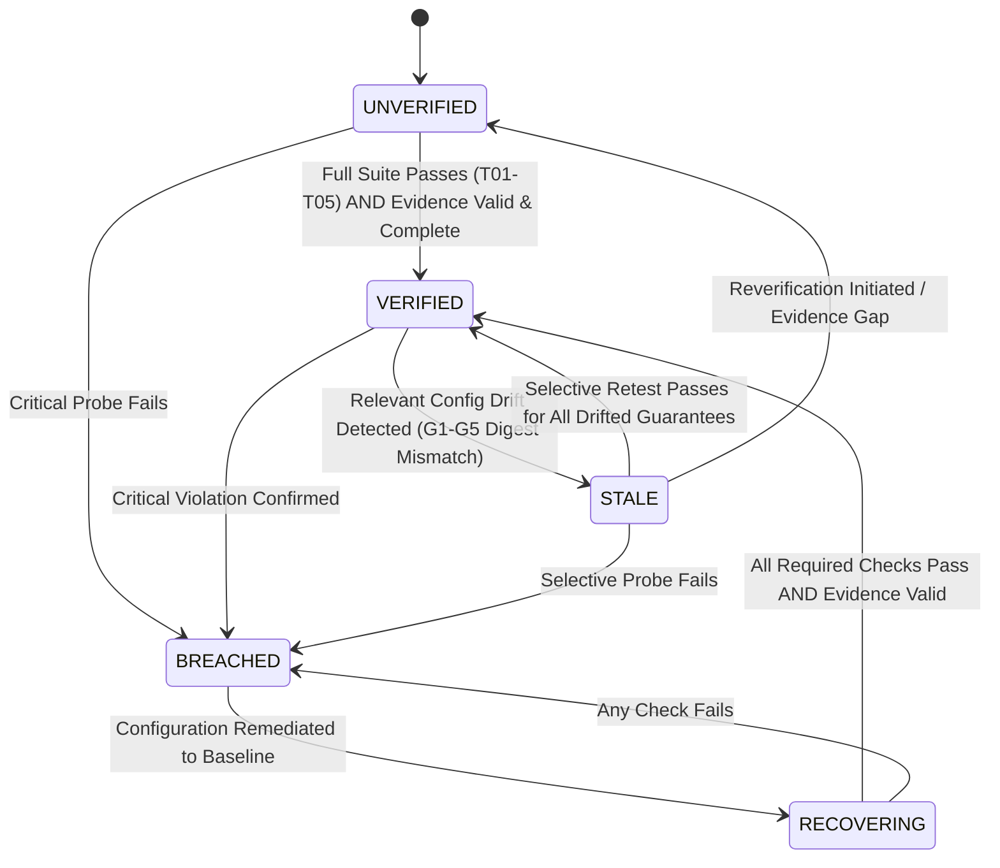
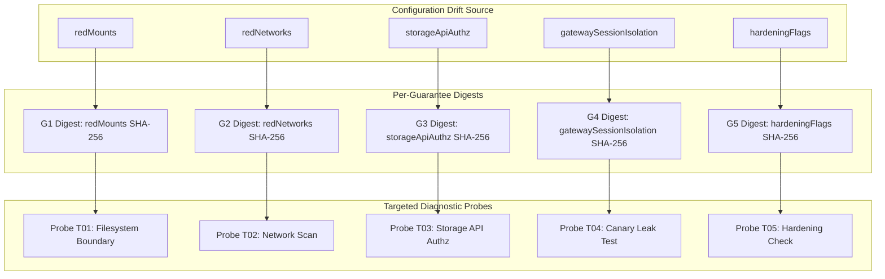

_BAYORA | TECHNICAL DESIGN & IMPLEMENTATION PLAN_

# **BAYORA**

Continuous Security Assurance for AI Evaluation Infrastructure

**Complete Architecture • Technology Stack • Implementation Roadmap • Evaluation Benchmark**

**Continuous Verification for Adversarial AI Safety Testing Infrastructure**

Team working document | Version 1.1 | 13 October 2026

_Purpose: align the team on the problem, architecture, build scope, formal security semantics, measurable demonstration, and defensible evaluation benchmark._

---

## **Document control**

| **Item** | **Details** |
| :--- | :--- |
| Project name | Bayora |
| Working tagline | Continuously verify that an AI evaluation environment's isolation guarantees remain supported by current configuration, executable tests, and independently checkable evidence. |
| Project domain | Securing Adversarial AI Safety Testing Infrastructure |
| Document status | **Version 1.1 (Formalized Architecture & Experimental Benchmark)**; incorporates reviewer feedback on state machines, audit completeness protocols, decoupled drift/breach schemas, and selective retesting metrics. |
| Primary deliverable | A working proof of concept with repeatable isolation-regression tests, dependency-mapped selective verification, and independently verifiable cryptographic evidence. |
| Scope note | This document describes a prototype and experimental evaluation harness, not a production multi-tenant cloud security certification. |

---

## **Executive summary**

Bayora is an architectural assurance layer for environments where red-team adversarial harnesses, blue-team evaluation planes, and model inference proxies must operate concurrently without exposing sensitive tenant state. Instead of building another jailbreak generator or a passive security dashboard, Bayora continuously evaluates whether declared security guarantees remain supported by cryptographic evidence after runtime drift or configuration changes.

The system captures a canonical environment manifest, computes deterministic SHA-256 fingerprints, maintains dependency-mapped per-guarantee digests, executes automated isolation probes, detects intentional configuration mutations, and records evidence in an append-only cryptographic hash chain. When configuration drifts, Bayora flags affected guarantees as `STALE`, enables targeted **selective retesting**, and enforces a **fail-closed Zero Trust policy gate** preventing untrusted evaluation runs until verification is restored.

### Key Differentiators to Validate
1. **Change-Aware Verification Loop**: Connecting configuration state, policy-derived tests, evidence freshness, and fail-closed gate enforcement.
2. **Selective Retesting Optimization**: Executing only the diagnostic probes mapped to drifted guarantees, measuring execution reduction ($R$) without missing regressions.
3. **Dual-Property Evidence Protocol**: Distinguishing cryptographic **integrity** (tamper detection) from **completeness** (manifest-driven omission detection).

---

## **1. Problem and opportunity**

### **1.1 Problem**
In adversarial AI safety testing, red-team tools execute untrusted jailbreak payloads and attack routines against model proxies, while the blue-team control plane manages gold-standard benchmarks, ground-truth evaluations, and scoring models. Isolation can degrade silently through:
- Misconfigured container bind mounts exposing blue directories to red runners.
- Overly permissive container network bridging across tenant subnets.
- Storage service role/scope relaxation allowing anonymous or cross-tenant object access.
- Shared model gateway inference contexts or KV-cache bleeding across evaluation sessions.
- Dropped container workload hardening flags (writable rootfs, excess Linux capabilities).

A static audit report from deployment time is invalidated the moment an operator or script alters runtime parameters.

### **1.2 Proposed solution**
- **Normalized Manifest & Canonical Fingerprint**: Extract security-relevant parameters into lexicographically sorted canonical JSON and compute a SHA-256 baseline fingerprint.
- **Per-Guarantee Digests**: Maintain independent cryptographic digests for each isolation boundary ($G_1$–$G_5$).
- **Dependency-Mapped Probes**: Map drifted configuration fields directly to specific diagnostic tests ($T01$–$T05$).
- **Controlled Reversible Mutation Lab**: Test the verification engine against deliberate perimeter mutations, including negative controls (benign metadata changes).
- **Dual-Property Cryptographic Ledger**: Hash-chain all run events and validate against an `expected_plan` manifest to catch both payload tampering and omitted events.
- **Fail-Closed Zero Trust Arbiter**: Block new adversarial evaluation runs by default whenever the assurance state is `UNVERIFIED`, `STALE`, `BREACHED`, or `RECOVERING`.

### **1.3 What Bayora is not**
- Not a new LLM or jailbreak-generation engine (e.g., garak/PyRIT workloads are clients of the sandbox, not the verifier).
- Not a replacement for container runtimes (Docker, gVisor), OPA, or enterprise SIEM platforms.
- Not a mathematical proof that hardware microarchitectural side-channels or zero-day kernel exploits are impossible.
- Not a production multi-tenant cloud security product at the MVP prototype stage.

---

## **2. Goals, non-goals, and success criteria**

| **Type** | **Definition** |
| :--- | :--- |
| **Goal** | Demonstrate three isolated roles: Adversarial Harness (Red), Control Plane (Blue), and Inference Proxy (Model Gateway). |
| **Goal** | Detect deliberately injected configuration regressions end-to-end and immediately trigger fail-closed policy lockdown. |
| **Goal** | Invalidate assurance evidence dynamically when relevant configuration changes, identifying exactly which guarantees drifted. |
| **Goal** | Demonstrate selective retesting that reduces test execution latency ($R > 70\%$) while detecting 100% of mapped regressions. |
| **Goal** | Provide an independent verifier capable of distinguishing payload tampering from omitted lifecycle events. |
| **Goal** | Enforce recovery: require remediation back to baseline plus passing diagnostic probes before re-granting access. |
| **Non-goal** | Prove absence of all timing, cache, hardware (Rowhammer), or hypervisor/kernel side-channels. |
| **Non-goal** | Execute untrusted kernel-exploit payloads against public cloud infrastructure. |
| **Non-goal** | Support dozens of heterogeneous cloud runtimes in the MVP. |

### **MVP Acceptance Criteria**
1. A clean baseline run executes, captures a canonical manifest, computes SHA-256 digests, and generates a valid signed audit chain.
2. At least four controlled security mutations ($M_1$–$M_4$) and one benign negative control ($B_1$) are implemented and reversible.
3. Injected mutations automatically transition the assurance state to `STALE` or `BREACHED`, and block policy gate access.
4. Selective retesting executes only the necessary probes for drifted guarantees, demonstrating measurable latency savings.
5. An altered audit record is detected as `TAMPERED` with the exact sequence index identified.
6. A dropped event is detected as `INCOMPLETE` citing the missing planned event key.
7. Restoring clean configuration and passing selective probes transitions the state from `RECOVERING` to `VERIFIED`.

---

## **3. System architecture & trust boundaries**

### **3.1 Logical Architecture**

```
                  ┌─────────────────────────────────────────────────────────┐
                  │                 OPERATOR DASHBOARD                      │
                  │       (Presentation Layer · Zero Trust Client)          │
                  └────────────────────────────┬────────────────────────────┘
                                               │ HTTPS / REST API
                                               ▼
                  ┌─────────────────────────────────────────────────────────┐
                  │                 FASTAPI CONTROL PLANE                   │
                  │   Run Lifecycle · Policy Gate Arbiter · Assurance State │
                  └──────┬─────────────────────┬─────────────────────┬──────┘
                         │                     │                     │
       ┌─────────────────▼────────┐   ┌────────▼──────────────┐   ┌──▼──────────────────┐
       │   Manifest & Fingerprint │   │   Policy Evaluator    │   │ Verification Engine │
       │   Canonical Normalizer   │   │   Registry & Mappings │   │ Automated Probes    │
       └──────────────────────────┘   └───────────────────────┘   └──┬──────────────────┘
                                                                     │
                         ┌───────────────────────────────────────────┤
                         ▼                                           ▼
       ┌───────────────────────────────────┐       ┌───────────────────────────────────┐
       │      DISPOSABLE TEST LAB          │       │      EVIDENCE LOGGING SERVICE     │
       │  ┌───────────┐     ┌───────────┐  │       │  Canonical JSON Serialization     │
       │  │ Red Team  │     │ Blue Team │  │       │  SHA-256 Hash Chaining            │
       │  │ (Runner)  │     │ (Control) │  │       │  Event Sequence Indexing          │
       │  └─────┬─────┘     └─────┬─────┘  │       └─────────────────┬─────────────────┘
       │        │                 │        │                         │
       │        └────────┬────────┘        │                         ▼
       │                 ▼                 │       ┌───────────────────────────────────┐
       │       ┌───────────────────┐       │       │    INDEPENDENT CHECKPOINT STORE   │
       │       │   Model Gateway   │       │       │  Separately Permissioned Storage  │
       │       │   Session Cache   │       │       │  Ed25519 Checkpoint Signatures    │
       │       └───────────────────┘       │       └─────────────────┬─────────────────┘
       └───────────────────────────────────┘                         │
                                                                     ▼
                                                   ┌───────────────────────────────────┐
                                                   │       INDEPENDENT VERIFIER        │
                                                   │  Standalone Verification CLI      │
                                                   │  Integrity & Completeness Proof   │
                                                   └───────────────────────────────────┘
```

### **3.2 Trust Boundaries and Architectural Roles**

| **Component** | **Trust Level** | **Boundary & Security Assumptions** |
| :--- | :--- | :--- |
| **Red-Team Runner** | **Untrusted** | Executes adversarial prompts, attack tools, and jailbreak suites. Must have zero visibility into blue storage volumes, admin networks, control plane secrets, or audit signing keys. |
| **Blue-Team Control** | **Protected Tenant** | Holds ground-truth evaluation datasets, gold-standard scoring models, and private rubrics. Strictly isolated from red runner network traffic and storage. |
| **Model Gateway** | **Restricted Proxy** | Proxies prompts to model backends. Strictly isolates session contexts and KV-caches; never exposes host mounts or administrative APIs to tenant containers. |
| **Control Plane** | **Trusted Orchestrator** | Coordinates run lifecycles and evaluates policy gate decisions. Does not execute untrusted tenant code within the API process. |
| **Evidence Writer** | **Trusted Logger** | Appends structured canonical events into the local run ledger. Cannot rewrite previously anchored checkpoints. |
| **Checkpoint Signer** | **Isolated Signer** | Holds Ed25519 signing keys outside tenant containers and independent of the raw event writer process. |
| **Independent Checkpoint Store**| **Separate Trust Boundary** | Retains signed checkpoint digests in write-once / append-only storage with permissions separate from the database. |
| **Independent Verifier**| **Independent Auditor** | Standalone tool that recomputes hashes, verifies signatures, and validates event sequences without relying on the dashboard or control plane. |
| **Host Kernel & Runtime** | **TCB (Trusted Computing Base)** | **Explicit Assumption**: The host Linux kernel, containerd/Docker daemon, and CPU/RAM are assumed intact. A compromised kernel invalidates all container sandbox guarantees. |

---

## **4. Formal assurance state machine**

Bayora implements a formal deterministic state machine with strict precedence rules, ensuring that stale, breached, or unverified environments can never be granted evaluation access.



### **4.1 Inviolable Precedence Rules**
1. **Critical Violation Precedence**: A confirmed boundary violation (`policy_test_status == FAIL`) takes precedence over all other statuses and forces immediate transition to `BREACHED`.
2. **Completeness Failure ≠ Compromise**: A missing event flags `evidence_completeness_status = INCOMPLETE` and transitions the state to `UNVERIFIED` (fail-closed lockdown), distinguishing missing evidence from active exploitation.
3. **No Inheritance Across Config Drift**: A newly captured configuration fingerprint can never inherit `VERIFIED` from a predecessor.
4. **Derived State Principle**: The `assurance_state` is strictly computed by the assurance engine from verified facts and is never directly writable via API or database queries.

### **4.2 Deterministic State Transition Matrix**

| Source State | Trigger Event | Guard Condition | Target State | Policy Gate Decision |
| :--- | :--- | :--- | :--- | :--- |
| `UNVERIFIED` | `run.completed` | All 5 tests `PASS` ∧ Evidence `VALID` ∧ `COMPLETE` | `VERIFIED` | **GRANTED** (Issue Ticket) |
| `UNVERIFIED` | `test.completed` | Any test `FAIL` | `BREACHED` | **DENIED** (Fail-Closed) |
| `VERIFIED` | `config.drift` | Security config changes ($G_x$ digest mismatch) | `STALE` | **DENIED** (Selective retest required) |
| `VERIFIED` | `config.drift` | Non-security metadata change ($B_1$ label edit) | `VERIFIED` | **GRANTED** (Invariant hash) |
| `STALE` | `test.completed` | Mapped selective probes `PASS` ∧ Evidence `VALID` | `VERIFIED` | **GRANTED** (Restored) |
| `STALE` | `test.completed` | Any mapped selective probe `FAIL` | `BREACHED` | **DENIED** (Perimeter Breach) |
| `BREACHED` | `config.remediated` | Active configuration matches baseline digest | `RECOVERING` | **DENIED** (Retest required) |
| `RECOVERING` | `test.completed` | All required tests `PASS` ∧ Evidence `VALID` | `VERIFIED` | **GRANTED** (Re-attested) |
| *ANY* | `evidence.tamper` | Hash chain broken OR event payload altered | `UNVERIFIED` | **DENIED** (Ledger Corrupt) |
| *ANY* | `evidence.missing`| Expected event missing from planned manifest | `UNVERIFIED` | **DENIED** (Run Incomplete) |

### **4.3 Decoupled Status Fields Schema**
To separate configuration drift, test execution, evidence integrity, and access policy:

```json
{
  "run_id": "run-20261013-alpha7",
  "environment_id": "eval-sandbox-us-east",
  "manifest_digest": "sha256:7c9e1b2f483a...",
  "configuration_status": "DRIFTED",
  "policy_test_status": "FAIL",
  "evidence_integrity_status": "VALID",
  "evidence_completeness_status": "COMPLETE",
  "assurance_state": "BREACHED",
  "drift_details": {
    "affected_guarantees": ["G3"],
    "required_retests": ["T03"]
  },
  "gate_evaluation": {
    "decision": "DENIED",
    "reasons": [
      "Assurance state is BREACHED.",
      "Active boundary failure on G3: Storage API operating in relaxed authorization mode."
    ],
    "required_retests": ["T03"]
  }
}
```

---

## **5. Technology stack & implementation scope**

To ensure hackathon completion, Bayora focuses on a clean, robust, and measurable implementation.

| **Layer** | **MVP Decision** | **Rationale** |
| :--- | :--- | :--- |
| **Verification & Crypto** | Web Crypto SHA-256 / Python 3.11+ `hashlib` | Zero synthetic math; standard, high-performance cryptographic primitives. |
| **API / Control Plane** | FastAPI + Pydantic (or Embedded TS Engine) | Strongly typed models, deterministic validation, clear API contracts. |
| **Operator UI** | React 19 + TypeScript + Vite + Tailwind CSS | Responsive, enterprise-grade dark telemetry workbench with zero fluff. |
| **Lab Runtime** | Docker Compose with 3 isolated roles | Repeatable multi-tenant setup with distinct virtual networks and volume mounts. |
| **Policy Engine** | Typed Guarantee-to-Probe Dependency Module | Transparent mapping without the setup overhead of external OPA services. |
| **Model Inference** | Deterministic Mock Inference Proxy | Ensures 100% reproducible canary evaluations without model download latency. |
| **Evidence & Checkpoints** | Canonical JSON, SHA-256 Hash Chains, Ed25519 Signatures | Tamper-evident ledger verifiable by external command-line utilities. |
| **Telemetry & Metrics** | High-precision timers (`performance.now()` / monotonic clocks) | Real, measured latency and duration values. |

---

## **6. Modules and responsibilities**

1. **Manifest Collector**: Normalizes configuration files, container image digests, network bridges, volume mounts, and security flags into sorted canonical JSON; computes baseline fingerprint.
2. **Per-Guarantee Digest Engine**: Computes isolated SHA-256 digests for individual guarantees ($G_1$–$G_5$).
3. **Change & Drift Detector**: Compares active digests against baseline digests; isolates drifted guarantees and enables selective retesting.
4. **Automated Probe Engine**: Executes diagnostic probes ($T01$–$T05$) simulating adversarial traversal, cross-tenant file reads, and canary leakage.
5. **Evidence Logging Service**: Constructs canonical events, binds previous-event hashes, and manages chain sequence counters.
6. **Independent Verifier**: Standalone verification utility checking chain pointer consistency, payload hashes, and `expected_plan` completeness.
7. **Fail-Closed Policy Arbiter**: Default-deny gate intercepting evaluation requests, issuing signed attestation tickets only when `assurance_state == VERIFIED`.
8. **Mutation Lab Engine**: Injects allowlisted configuration mutations and negative controls to test verification effectiveness.

---

## **7. Isolation guarantees and diagnostic probe matrix**

```
Guarantee Matrix: G1–G5
├── G1: Storage Isolation        ──► Probe T01: Filesystem Boundary Check
├── G2: Network Isolation        ──► Probe T02: Network Microsegmentation Scan
├── G3: API Authorization        ──► Probe T03: Storage API Scope Assertion
├── G4: Session Confidentiality  ──► Probe T04: Canary Token Leak Test
└── G5: Workload Hardening       ──► Probe T05: Container Security Context Check
```

| Guarantee | ID | Target Role | Automated Probe | Pass Condition | Failure Condition |
| :--- | :---: | :---: | :--- | :--- | :--- |
| **Storage Isolation** | `G1` | `red` | `T01`: Filesystem Boundary Check | Mount points strictly confined to `/opt/red/workspace`. | Mounts `/opt/blue/*` or host root `/`. |
| **Network Isolation** | `G2` | `red` | `T02`: Network Microsegmentation Scan | Connected solely to `red-isolated-net`. | Joins `blue-private-net` or admin bridge. |
| **API Authorization** | `G3` | `infra` | `T03`: Storage API Scope Assertion | Strict cryptographic bearer token validation active. | Storage API operates in `relaxed` mode. |
| **Session Confidentiality** | `G4` | `gateway`| `T04`: Canary Token Leak Test | 128-bit canary token in Blue context is undetectable in Red queries. | Model gateway context cache configured with `shared` pool. |
| **Workload Hardening** | `G5` | `red` | `T05`: Container Hardening Check | `readOnlyRoot: true`, capabilities dropped to `ALL`, `noNewPrivileges: true`. | Rootfs writable, excess capabilities, or seccomp disabled. |

---

## **8. Environment fingerprint and selective retesting**

### **8.1 Manifest Scoping & Fingerprint Structure**
A cryptographic fingerprint proves that two canonical configuration manifests match. It does not replace behavioral tests; it determines **when tests must be re-run**.

Bayora distinguishes three digests:
1. **`configuration_digest`**: Captured from declared infrastructure configuration (mounts, networks, authz modes, security flags).
2. **`runtime_observation_digest`**: Captured from active runtime telemetry (inspection of running container state).
3. **`evidence_digest`**: Root hash of the latest finalized audit verification block.

```json
{
  "manifest_schema": "1.1",
  "runtime": { "name": "docker-engine", "version": "27.3.1" },
  "policy_bundle_version": "v1.1.0",
  "test_suite_version": "v1.1.0",
  "threat_model_version": "1.1",
  "security_relevant_config": {
    "gatewaySessionIsolation": "strict",
    "hardeningFlags": {
      "dropCapabilities": ["ALL"],
      "noNewPrivileges": true,
      "readOnlyRoot": true,
      "seccompProfile": "docker/default"
    },
    "redMounts": ["/opt/red/workspace"],
    "redNetworks": ["red-isolated-net"],
    "storageApiAuthz": "strict"
  },
  "configuration_digest": "sha256:8f4c2e..."
}
```

### **8.2 Selective Retesting Dependency Graph**



### **8.3 Selective Retesting Efficiency Metric**
To evaluate selective verification against full re-verification, Bayora reports the **Unnecessary Retest Reduction ($R$)**:

$$R = 1 - \frac{T_{\text{selective}}}{T_{\text{full}}}$$

- $T_{\text{selective}}$: Execution duration of targeted probes triggered by drifted guarantees.
- $T_{\text{full}}$: Execution duration of running the full probe suite ($T01$–$T05$).
- **Safety Invariant**: For all defined mutations, $R > 0$ while the regression detection rate remains $100\%$. If dependency impact is uncertain, the system falls back to a full re-verification.

---

## **9. Audit and provenance design: dual-property protocol**

Bayora enforces both **Integrity** (anti-tampering) and **Completeness** (anti-omission).

```
Hash Chain Linkage:
Event[0] (Genesis: 0000...0000) ──► Event[1] Hash ──► Event[2] Hash ──► Event[3] Hash
                                      │                     │
                             (Previous Hash Pointer)        └── Payload Mutated? ➔ TAMPERED!
```

### **9.1 Event Structure**
```json
{
  "sequence": 4,
  "run_id": "run-20261013-alpha7",
  "timestamp": "2026-10-13T09:45:00.120Z",
  "event_type": "test.completed",
  "payload": {
    "test_id": "T03",
    "guarantee_id": "G3",
    "status": "PASS",
    "duration_ms": 420,
    "details": "Strict token authz active. Synthetic unauthorized request rejected."
  },
  "previous_event_hash": "e3b0c44298fc1c149afbf4c8996fb92427ae41e4649b934ca495991b7852b855",
  "event_hash": "9b12a865f01e23a45c6789def0123456789abcdef0123456789abcdef0123456"
}
```

### **9.2 Seven-Stage Declared Lifecycle Protocol**

| Step | Required Event Type | Purpose in Lifecycle | Completeness Validation |
| :---: | :--- | :--- | :--- |
| **1** | `run.started` | Establishes run identity; declares `expected_plan` manifest. | Manifest locks all expected event keys. |
| **2** | `manifest.captured` | Binds configuration digest and runtime metadata. | Validates baseline reference. |
| **3** | `test.started` | Initiates individual boundary probe execution. | Paired with subsequent test completion. |
| **4** | `test.completed` | Records probe diagnostic outcome, status, and duration. | Missing pairs flag run as `INCOMPLETE`. |
| **5** | `policy.decision` | Records assurance state verdict and gate evaluation. | Validates fail-closed state consistency. |
| **6** | `checkpoint.signed` | Creates Ed25519 cryptographic checkpoint signature. | Anchors ledger to external trust boundary. |
| **7** | `run.completed` | Terminal sealing event recording total duration. | Validates that run was not aborted early. |

---

## **10. Model confidentiality experimental tracks**

To address cross-session inference context leakage without overclaiming side-channel immunity:

- **Level A — Application-Layer Isolation**: Verifies that tenant session authorization tokens cannot query prompt history, output buffers, or completion logs belonging to other tenants.
- **Level B — Shared-State & Context Cache Isolation**: Injects high-entropy 128-bit canary tokens (`CANARY-7X9B-...`) into Blue evaluation prompts and executes adversarial prefix-matching queries from Red runners. Detects multi-tenant context reuse in shared inference proxies (e.g., vLLM prefix-cache misconfigurations).
- **Level C — Microarchitectural Timing Side-Channels (Explicit Limitation / Stretch)**: Research into GPU memory bus timing and co-located batching side channels. Formally documented as outside the MVP prototype scope.

---

## **11. Security model, limitations, and safe lab rules**

### **11.1 Threats Addressed in MVP**
- Cross-tenant directory traversals and unauthorized bind mounts.
- Inter-tenant network bridge traversal and administrative port exposure.
- Storage service role/scope degradation.
- Multi-tenant model inference KV-cache canary leakage.
- Container workload privilege escalation via writable rootfs or excess Linux capabilities.
- Audit ledger payload falsification and dropped lifecycle events.

### **11.2 Explicit Residual Risks & Out-of-Scope Limitations**
- **Host OS & Hypervisor Trust**: Kernel vulnerabilities, dirty cow/pipe, runc breakouts, or compromised container daemons are out of scope.
- **Hardware & Microarchitectural Exploits**: Physical fault injections (Rowhammer), speculative execution attacks (Spectre/Meltdown), and GPU co-tenancy timing channels are excluded.
- **Total Compromise of Signer**: If an attacker compromises the private checkpoint signing key and independent store, they can generate alternative valid chains.

### **11.3 Safe Lab Rules**
- Mutation tests run only in disposable sandbox environments with synthetic credentials.
- The Docker socket is never mounted into tenant containers.
- Mutation endpoints accept only allowlisted IDs—no arbitrary shell commands or user-supplied host paths.
- All network isolation defaults to deny.

---

## **12. Controlled mutation benchmark & negative controls**

Bayora validates its detection mechanisms against five predefined, reversible mutation scenarios:

```yaml
schema_version: "1.1"
mutations:
  - id: "M1_RELAX_AUTHZ"
    name: "Storage API Authorization Relaxation"
    target_boundary: "storage_api"
    affected_guarantee: "G3"
    mapped_probe: "T03"
    mutation: { storageApiAuthz: "relaxed" }
    expected_status: "BREACHED"
    cleanup: { storageApiAuthz: "strict" }

  - id: "M2_MOUNT_LEAK"
    name: "Cross-Tenant Bind Mount Exposure"
    target_boundary: "filesystem"
    affected_guarantee: "G1"
    mapped_probe: "T01"
    mutation: { redMounts: ["/opt/red/workspace", "/opt/blue/data"] }
    expected_status: "BREACHED"
    cleanup: { redMounts: ["/opt/red/workspace"] }

  - id: "M3_BRIDGE_NETWORK"
    name: "Cross-Tenant Network Subnet Attachment"
    target_boundary: "network"
    affected_guarantee: "G2"
    mapped_probe: "T02"
    mutation: { redNetworks: ["red-isolated-net", "blue-private-net"] }
    expected_status: "BREACHED"
    cleanup: { redNetworks: ["red-isolated-net"] }

  - id: "M4_GATEWAY_CACHE"
    name: "Model Gateway Shared Context Pool"
    target_boundary: "model_gateway"
    affected_guarantee: "G4"
    mapped_probe: "T04"
    mutation: { gatewaySessionIsolation: "shared" }
    expected_status: "BREACHED"
    cleanup: { gatewaySessionIsolation: "strict" }

  - id: "B1_METADATA_LABEL"
    name: "Benign Metadata Label Modification (Negative Control)"
    target_boundary: "metadata"
    affected_guarantee: null
    mapped_probe: null
    mutation: { labels: { "audit.note": "annotation-session-42" } }
    expected_status: "VERIFIED"
    cleanup: { labels: {} }
```

---

## **13. Repository layout**

```
bayora/
├── public/                     # Static assets & icons
│   ├── favicon.svg
│   └── icons.svg
├── src/
│   ├── assets/                 # Brand assets
│   ├── components/             # Operator UI Components
│   │   ├── EvidenceLogTable.tsx# Audit ledger & tamper simulator
│   │   ├── FailClosedGate.tsx  # Fail-closed policy gate arbiter
│   │   ├── GuaranteesTable.tsx # Policy matrix (G1–G5)
│   │   ├── MutationLab.tsx     # Mutation simulator & container topologies
│   │   ├── RunControls.tsx     # Probe execution engine
│   │   ├── StatusBanner.tsx    # Executive KPI header & hash chip
│   │   └── ThreatModelPanel.tsx# Threat model & boundary specification
│   ├── services/
│   │   └── simulation.ts       # Baseline config, G1–G5 rules & test runners
│   ├── utils/
│   │   └── crypto.ts           # Canonical JSON, SHA-256, hash chain validator
│   ├── types.ts                # Domain contracts & status schemas
│   ├── App.tsx                 # Core state orchestrator
│   ├── index.css               # Design tokens & Tailwind CSS
│   └── main.tsx                # Application bootstrap
├── index.html                  # HTML entry point
├── vite.config.ts              # Vite & Tailwind bundler config
├── tsconfig.json               # Root TypeScript configuration
├── package.json                # Project dependencies & scripts
└── README.md                   # System documentation & walkthrough
```

---

## **14. API outline & data models**

| **Method & Route** | **Purpose & Authorization** |
| :--- | :--- |
| `POST /api/runs` | Start a verification run with a specified profile (`full` or `selective`). |
| `GET /api/runs/{id}` | Return run status, duration, and test execution results. |
| `GET /api/runs/{id}/evidence` | Return full evidence package including sequence hashes and checkpoint. |
| `POST /api/runs/{id}/verify-evidence` | Execute independent evidence verification; return `VALID`, `TAMPERED`, or `INCOMPLETE`. |
| `GET /api/environments/{id}/changes` | Compare active manifest against baseline; list drifted fields and affected guarantees. |
| `POST /api/environments/{id}/reverify` | Trigger selective retesting for drifted guarantees. |
| `GET /api/environments/{id}/assurance` | Return current assurance state, SHA-256 fingerprint, and gate verdict. |
| `POST /api/lab/mutations` | Apply an allowlisted mutation scenario (`M1`–`M4`, `B1`, or `REMEDIATE`). |

---

## **15. Operator dashboard views**

1. **Executive Posture Banner**: Live assurance badge (`VERIFIED`, `CONFIG DRIFT`, `BREACH DETECTED`, `RECOVERING`, `UNVERIFIED`), SHA-256 fingerprint toggle, audit chain status chip, and selective retest triggers.
2. **Guarantees Matrix (G1–G5)**: Real-time compliance matrix detailing target scopes, measured latencies, baseline freshness, and individual probe triggers.
3. **Drift & Mutation Lab**: Interactive injection panel for $M_1$–$M_4$ and $B_1$, visual container topologies, and configuration diff inspector.
4. **Zero Trust Policy Gate**: Interactive evaluation requester rendering certified attestation certificates (`TKT-BAYORA-...`) or fail-closed denial cards.
5. **Cryptographic Audit Ledger**: Interactive hash chain inspector with SHA-256 verification and tamper/drop simulation controls.
6. **Threat Model & Scope Specification**: Formal documentation of in-scope perimeter protections and explicit residual risks.

---

## **16. Team roles and workstreams**

| **Workstream** | **Ownership** | **Core Deliverable** |
| :--- | :--- | :--- |
| **Security & Threat Model Lead** | Threat model, sandbox isolation, G1–G5 definitions | Formally documented security boundaries and acceptance criteria. |
| **Cryptographic & Evidence Lead** | Canonical JSON, SHA-256 hash chains, independent verifier | Tamper-evident ledger with dual integrity/completeness validation. |
| **Orchestration & State Engine Lead**| State machine, selective retest mappings, mutation engine | Deterministic state transitions and policy gate arbiter. |
| **Frontend & Visualization Lead** | Executive dashboard, evidence inspector, topology views | Responsive, high-density telemetry workbench. |
| **Benchmarking & Demo Owner** | Performance measurement, mutation detection metrics, script | Repeatable live demo and defensible experimental data. |

---

## **17. Suggested build schedule**

- **Phase 0 — Alignment & Threat Model**: Finalize G1–G5 isolation boundaries, sign-off on formal state transitions, and define acceptance criteria.
- **Phase 1 — Core Cryptographic Engine**: Implement canonical JSON serialization, Web Crypto SHA-256 hashing, and hash-chain verification.
- **Phase 2 — Baseline Verification & Probes**: Implement diagnostic probes ($T01$–$T05$) and verify clean baseline execution.
- **Phase 3 — Drift Detection & Selective Retesting**: Implement per-guarantee digests and selective retest orchestrator.
- **Phase 4 — Mutation Lab & Fail-Closed Gate**: Build mutation scenarios ($M_1$–$M_4$), negative control ($B_1$), and Zero Trust policy arbiter.
- **Phase 5 — Tamper & Completeness Simulation**: Implement independent ledger verification with payload mutation and dropped-event detection.
- **Phase 6 — Demo Polish & Metrics Validation**: Measure latency, compute $R$, and rehearse the 5-minute evaluation demonstration.

---

## **18. Evaluation methodology & benchmark protocol**

### **18.1 Core Metrics**

| **Metric** | **Formula / Measurement Definition** |
| :--- | :--- |
| **Mutation Detection Rate ($D$)** | $D = \frac{\text{Detected Security Mutations}}{\text{Total Security Mutations Injected}}$ (Target: $100\%$ on defined corpus). |
| **False Positive Rate ($FPR$)** | $FPR = \frac{\text{Clean/Benign Configurations Flagged as Breached}}{\text{Total Clean Runs Evaluated}}$ (Target: $0.0\%$). |
| **Selective Retest Reduction ($R$)** | $R = 1 - \frac{T_{\text{selective}}}{T_{\text{full}}}$ (Measures verification time saved). |
| **Integrity Detection Rate** | Proportion of mutated payload events detected during ledger audit. |
| **Completeness Detection Rate**| Proportion of omitted lifecycle events detected via `expected_plan`. |
| **Time to Detect ($TTD$)** | Latency from configuration mutation to fail-closed state transition. |
| **Recovery Latency ($T_{\text{rec}}$)** | Latency from baseline remediation to verified state re-attestation. |

---

## **19. Demo script (5 minutes)**

1. **0:00–0:45 | Establish Roles & Boundaries**: Present the three isolated roles: Adversarial Harness (Red), Control Plane (Blue), and Inference Proxy (Model Gateway). Highlight the initial `UNVERIFIED` state and demonstrate that the Policy Gate denies evaluation access by default.
2. **0:45–1:30 | Baseline Verification & Attestation**: Click **"Verify All (5 Probes)"**. Watch probes execute with measured latency. Observe the state transition to `VERIFIED`. Click **"Request Evaluation Access"** to show the signed attestation certificate (`TKT-BAYORA-...`).
3. **1:30–2:30 | Configuration Drift & Selective Retesting**: In the Mutation Lab, click **`M1: Relax Authz`**. The status immediately flips to `CONFIG DRIFT (STALE)`, flagging only guarantee $G_3$. Click **`Run Selective Retest (1 probe: T03)`**. Probe $T03$ fails, transitioning the posture to `BREACH DETECTED` and locking the policy gate.
4. **2:30–3:15 | Remediation & Restored Assurance**: Click **`Remediate to Baseline`** (state moves to `RECOVERING`). Re-run selective probe $T03$. The test passes and the environment returns to `VERIFIED`. Click **`B1: Metadata Label`** to prove that benign changes do not alter the security fingerprint or degrade assurance.
5. **3:15–4:15 | Audit Integrity & Completeness Verification**: Navigate to the Audit Ledger. Click **`Verify Ledger`** to validate all cryptographic links. Click **`Simulate Tamper`** to show immediate detection of payload alteration. Click **`Simulate Drop`** to demonstrate that omitted events are flagged as `INCOMPLETE`.
6. **4:15–5:00 | Metrics, Residual Risks & Conclusion**: Review the Threat Model tab, present measured latency and retest reduction ($R$), summarize explicit trust assumptions (host kernel as TCB), and conclude.

---

## **20. Risks and mitigations**

| **Identified Risk** | **Architectural Mitigation** |
| :--- | :--- |
| Overlapping novelty with existing tools | Position Bayora around continuous change-aware verification, per-guarantee digests, and fail-closed policy enforcement rather than attack generation. |
| Scope creep causes unfinished implementation | Focus on the core 3-role lab, 5 diagnostic probes, 5 mutation fixtures, and native browser Web Crypto. |
| Selective retesting misses a regression | Maintain conservative dependency mappings; fall back to full verification whenever field impact is ambiguous. |
| Green dashboard breeds false confidence | Expose raw cryptographic hashes, measured latencies, and explicit residual risk disclaimers directly in the UI. |

---

## **21. Prior art and implementation references**

- **Microsoft PyRIT**: Python Risk Identification Toolkit for generative AI red-teaming (https://github.com/Azure/PyRIT)
- **NVIDIA garak**: LLM vulnerability scanner (https://github.com/NVIDIA/garak)
- **Agent Sandbox Taxonomy**: Taxonomy of AI agent sandbox isolation boundaries (https://github.com/kajogo777/the-agent-sandboxtaxonomy)
- **Google gVisor**: Application kernel sandbox boundary (https://github.com/google/gvisor)
- **Open Policy Agent (OPA)**: Declarative policy engine (https://github.com/open-policy-agent/opa)
- **Sigstore Rekor**: Signature transparency ledger for container provenance (https://github.com/sigstore/rekor)
- **OWASP GenAI Security Project**: Architectural security guidance for generative AI (https://genai.owasp.org/)

---

## **22. Decisions resolved before coding**

1. **Host Environment**: Windows local workstation / modern Linux container environment supporting Docker Compose.
2. **Policy Evaluation**: Strongly typed TypeScript / Python dependency module mapping configuration fields directly to guarantees.
3. **Mutation Scope**: Four security regressions ($M_1$–$M_4$) and one benign metadata negative control ($B_1$).
4. **Audit Lifecycle**: Seven-stage lifecycle bound to an `expected_plan` manifest for completeness verification.
5. **Key Management**: Standalone checkpoint signing keys held outside tenant container boundaries.
6. **Retest Threshold**: Guarantee-specific digest drift triggers selective retesting; full re-verification remains the fallback.
7. **Model Strategy**: Deterministic mock model with 128-bit canary tokens for repeatable, zero-latency testing.
8. **Evaluation Benchmark**: Reporting mutation detection rate ($D$), false positive rate ($FPR$), and retest reduction ($R$).

---

## **23. Pre-coding checklist**

- [x] Formalize assurance-state transitions with explicit precedence rules.
- [x] Freeze MVP scope: 3 tenant roles, 5 isolation guarantees, 5 mutation scenarios.
- [x] Specify dual-property evidence protocol (integrity vs. completeness).
- [x] Create machine-readable mutation specifications with negative controls.
- [x] Define selective retesting dependency graph and efficiency formula ($R$).
- [x] Establish evaluation benchmark methodology and demo script.

---

## **Appendix A — Definition of done**

- A new engineer can clone the repository, run `npm install && npm run dev`, and interact with the verifier immediately.
- Clean baseline verification computes deterministic SHA-256 digests and establishes the `VERIFIED` posture.
- All four security mutations ($M_1$–$M_4$) trigger fail-closed lockdown, while benign mutation $B_1$ leaves assurance intact.
- Independent ledger validation detects both altered payloads (`TAMPERED`) and omitted events (`INCOMPLETE`).
- Baseline remediation plus selective retesting restores `VERIFIED` status.
- The policy gate grants evaluation access only when the environment is cryptographically certified.
- Real measured latencies and zero synthetic metrics are displayed throughout.

---

## **Appendix B — One-sentence project description**

**Bayora continuously verifies whether an AI red-teaming environment’s isolation guarantees remain supported by current configuration, executable security tests, and independently checkable evidence.**
