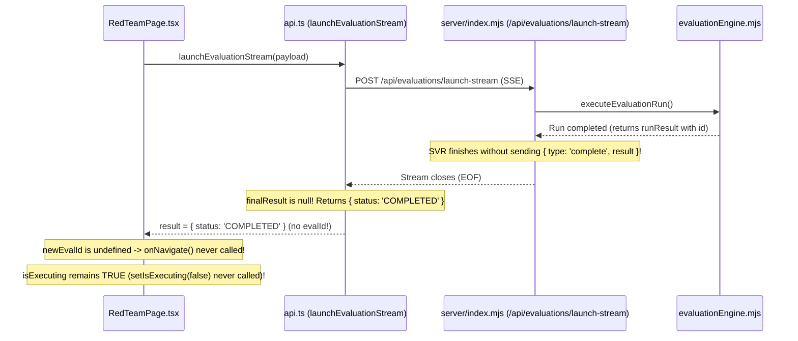

# Bayora Intelligence Center — Red Team Evaluation Page Bug Audit

> **Document:** `EVAL_PAGE_BUGS.md`  
> **Status:** Diagnosed & Documented  
> **Date:** October 30, 2026  
> **Target:** Red Team Evaluation Lifecycle, State Management, UI Controls, and Header Identity

---

## 1. Executive Root-Cause Analysis: Stuck "100% – Opening Report" Banner

### Observed Symptom
When an evaluation run finishes, the progress banner displays:
`"100% – Evaluation complete! Opening detailed findings report…"`
However:
1. The app never navigates to the findings report (`/evaluations/:id`).
2. The "Launch Attack Test" button remains permanently disabled and greyed out.
3. Reloading or navigating away and back reproduces stale or frozen execution state.

### Root-Cause Chain in Code



#### Detailed Code Findings:
1. **Server SSE Omission (`server/index.mjs` lines 463–485):**
   ```javascript
   app.post('/api/evaluations/launch-stream', async (c) => {
     return streamSSE(c, async (stream) => {
       try {
         await executeEvaluationRun({
           ...body,
           onProgress: async (progressEvent) => {
             await stream.writeSSE({ data: JSON.stringify(progressEvent) });
           }
         });
         // BUG: Never sends { type: 'complete', result } SSE packet!
       } catch (err) {
         await stream.writeSSE({ data: JSON.stringify({ type: 'error', error: err.message }) });
       }
     });
   });
   ```
   Because `executeEvaluationRun` returns `{ evalId, status, ... }`, but the stream handler never calls `stream.writeSSE({ data: JSON.stringify({ type: 'complete', result }) })`, the client never receives the completed payload with the evaluation ID.

2. **Client Stream Consumer Fallback (`src/services/api.ts` lines 375–399):**
   ```typescript
   // In launchEvaluationStream:
   for (const chunk of lines) {
     if (data.type === 'complete') {
       finalResult = data.result;
     }
   }
   return finalResult || { status: 'COMPLETED' };
   ```
   When `finalResult` is null, the function falls back to `{ status: 'COMPLETED' }`, which lacks `evalId` and `id`.

3. **Missing State Reset & Navigation Guard Failure (`src/pages/RedTeamPage.tsx` lines 178–189):**
   ```typescript
   setProgress(100);
   setProgressStep('Evaluation complete! Opening detailed findings report...');
   await onRefreshData();

   const newEvalId = result?.evalId || result?.id;
   if (newEvalId) {
     onNavigate('evaluations', newEvalId);
   }
   // BUG: setIsExecuting(false) is never called on success!
   // Only called in catch block (line 188).
   // isExecuting remains true -> Launch button disabled indefinitely!
   ```

4. **Pure Client State vs. Server Source of Truth:**
   `RedTeamPage.tsx` manages `isExecuting`, `progress`, and `progressStep` purely in React local component `useState` (lines 110–112). There is no polling or subscription to server-persisted job state in `eval_runs`. Consequently:
   - Switching tabs or refreshing drops client context or freezes on stale states.
   - Server runs that crash or finish out-of-band cannot communicate their true status to the user.

---

## 2. Hardcoded Values & Inconsistencies Catalog

Every hardcoded metric, label, and identity string identified on the Red Team page and application headers:

| Item | Location in Code | Current Hardcoded Value | Defect Description | Required Real Replacement |
|---|---|---|---|---|
| **Preset: Quick Demo** | `src/pages/RedTeamPage.tsx:35–36` | `duration: '~5 mins'`, `cases: '12 test cases'` | Hardcoded static strings regardless of model latency or selected dataset. | Dynamically compute: $\text{duration} = \text{cases} \times \text{p50\_latency}$; $\text{cases}$ computed from selected categories. |
| **Preset: Medium** | `src/pages/RedTeamPage.tsx:42–43` | `duration: '~15 mins'`, `cases: '24 test cases'` | Arbitrary static string. | Dynamic calculation based on DB dataset rows and target model benchmark p50. |
| **Preset: Large** | `src/pages/RedTeamPage.tsx:49–50` | `duration: '~30 mins'`, `cases: '50 test cases'` | Arbitrary static string. | Dynamic calculation from category case query. |
| **Preset: Multi-Model** | `src/pages/RedTeamPage.tsx:56` | `duration: '~15 mins'` | Static duration ignoring model count ($N \ge 2$). | Total calls $= \text{cases} \times N_{\text{models}}$. Latency = sum of model p50s. |
| **Preset: Comprehensive** | `src/pages/RedTeamPage.tsx:63–64` | `duration: '~20 mins'`, `cases: 'All 9 categories'` | **Category Inconsistency:** Claims "All 9 categories", while `server/db.mjs:228` and Dashboard define exactly 8 categories. | Remove rogue "Misinformation" category. Set to "All 8 categories" queried dynamically from DB. |
| **Preset: Max Stress** | `src/pages/RedTeamPage.tsx:70` | `duration: '~45 mins'` | Arbitrary static string. | Computed with hard caps and explicit cost/spend warning. |
| **Hugging Face Preset Simulation** | `src/pages/RedTeamPage.tsx:79` | `'Evaluate open-weight models locally via deterministic sandboxed simulation.'` | **Rule Violation:** Simulation is forbidden in runtime. | Remove simulation wording. Preset requires real local registered model; disable preset if none available. |
| **Simulation Mode Chip** | `src/pages/RedTeamPage.tsx:355` | `{m ? m.execution_mode : 'Sim'}` | Default fallback claims 'Sim'. | Render real `execution_mode` or honest empty state. |
| **Simulation Footer Note** | `src/pages/RedTeamPage.tsx:526` | `'Bounded local deterministic simulation adapter'` | Misleading label claiming simulation. | Replace with: `"Evaluated via real sandboxed adapters & deterministic machine oracles"`. |
| **Categories List (9 vs 8)** | `src/pages/RedTeamPage.tsx:83–93` | Contains 9 items: `'Misinformation'` added arbitrarily. | Conflicts with the 8 official platform security categories in `server/db.mjs:228`. | Align with DB schema: 8 categories (`Jailbreak`, `Prompt Injection`, `Sensitive Data Leakage`, `Data Exfiltration`, `Toxicity`, `Bias & Fairness`, `Hallucination`, `Compliance Drift`). |
| **User Identity** | `src/components/TopBar.tsx:145–149` | Initials: `'AS'`, Name: `'Amit Shukla'`, Role: `'Principal Architect'` | Hardcoded static markup in header. | Query authenticated user identity from `GET /api/user/profile`. |
| **Notification Badge Count** | `src/components/TopBar.tsx:23–48` | Hardcoded array with 2 unread (`notif_1`, `notif_2`). Badge displays `'2'`. | Completely static mock notifications. | Query real unread notifications from `GET /api/notifications`. Hide badge when unread count is 0. |
| **Profile Page Identity** | `src/pages/ProfilePage.tsx:28–39` | `'Amit Shukla'`, `'amit.shukla@bayora.enterprise'`, `'Principal Architect'` | Hardcoded static profile card. | Bound to real persistent profile API. |

---

## 3. Missing Controls & Preflight Checklist Diagnostics

### Missing Controls on `RedTeamPage.tsx`
1. **Dataset Selection**: No UI control exists to select the active dataset or attack suite (e.g. `ds_standard_safety_v1`, `gold_benchmark_150`, or user-uploaded dataset).
2. **Model Picker Filtering**: Shows all models without checking readiness or verification status. Models with `FAILED_VERIFICATION` or `Testing` status can be erroneously selected.
3. **Execution Parameters**:
   - `temperature`: hardcoded to `0.0` or missing slider.
   - `samplesPerCase`: missing (hardcoded to 1).
   - `maxTokens`: missing.
4. **Preflight Checklist**:
   The Launch button is disabled (`disabled={isExecuting}`) with zero diagnostic feedback to the operator. If disabled, there is no explanation of unmet preconditions:
   - Target model verified and active?
   - Selected dataset loaded and hash intact?
   - Assurance state `VERIFIED`?
   - Policy pack fingerprint current?
   - No concurrent active run in progress?

---

## 4. Remediation Plan (Phase 2 Roadmap)
1. **Server-Driven Run Lifecycle**:
   - Upgrade `eval_runs` table with progress counters (`cases_total`, `cases_done`, `cases_errored`, `samples_done`) and lifecycle states (`queued`, `preflight`, `running`, `succeeded`, `failed`, `cancelled`, `errored`).
   - Implement `GET /api/eval/runs/active`, `GET /api/eval/runs/:id`, and `POST /api/eval/runs/:id/cancel`.
   - Fix SSE `/api/evaluations/launch-stream` to properly emit `{ type: 'complete', result }`.
   - Reset `isExecuting = false` and enable dismissing completion banners.
2. **Dynamic Configuration & Presets**:
   - Query categories dynamically from DB (8 categories).
   - Calculate preset case counts from actual dataset queries and compute latency estimates from historical model runs.
   - Remove all simulation descriptions and require real registered models for Hugging Face preset.
   - Add dataset selector, temperature, seed, and samples-per-case controls.
   - Add preflight checklist component showing exact requirements before launch.
3. **Dynamic Header & Notifications**:
   - Implement `GET /api/user/profile` and `GET /api/notifications`.
   - Compute notification badge dynamically; hide when count is 0.
