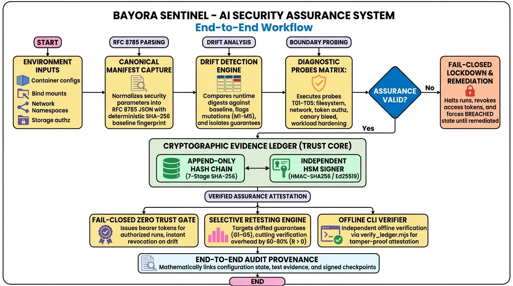

# Bayora

### Continuous AI Red-Teaming Infrastructure Verification and Fail-Closed Gate

AI red-team evaluations execute untrusted adversarial code alongside sensitive evaluation prompts, rubrics, and scoring models. If an environment's isolation boundaries degrade during testing, untrusted attacks can leak ground-truth data or corrupt benchmarks without notice. Bayora continuously proves that the isolation guarantees behind AI red-team evaluations still hold, and blocks runs the moment one stops holding.

AI explains, math decides: the allow/deny verdict is computed by deterministic code and is never influenced by an LLM.

**Live Deployment (Cached Mode)**: https://bayora-eval-assurance.vercel.app  
*Hosted note: The hosted page operates in Cached mode because public browsers cannot connect to a presenter's localhost model. Live mode runs on the presenter's machine with local Ollama.*



---

## Capabilities and Scope

| Real | Simulated | Not built |
| :--- | :--- | :--- |
| Canonical JSON serialization (RFC 8785) and SHA-256 fingerprinting | Red and blue container environments | Real Docker or Kubernetes daemon integration |
| Software signing key (ECDSA P-256 via Web Crypto) for tickets and checkpoints | Manifest-based boundary checks for storage mounts (G1), network (G2), API authz (G3), and container hardening (G5) | Kernel-level privilege escalation or container escape defenses (e.g., Dirty Pipe, runc escapes) |
| Append-only SHA-256 hash-chain audit ledger with Genesis anchoring | Reversible mutation injection and configuration drift simulator | Physical hardware fault injection (Rowhammer) or timing side-channel protection (Spectre, Meltdown, GPU co-location) |
| Offline independent evidence verifier CLI (scripts/verify.mjs) catching tampering and omissions | | Production cloud multi-tenant account or billing systems |
| Live canary token leak probe against a built-in test gateway calling a real model when run locally, with recorded cache fallback | | Autonomous policy mutation or LLM-driven gate verdicts |

---

## Quick Start

### Prerequisites
- Node.js 20 or later
- Optional: Local Ollama server (`http://localhost:11434`) with `llama3.2:3b` for live model probing. When Ollama is not running, Bayora automatically operates in Cached mode.

### Setup and Running Locally
```bash
# 1. Install dependencies
npm install

# 2. Run web client and API server together
npm run dev

# The web interface runs at http://localhost:5173
# The backend API runs at http://localhost:3001
```

### Running with a Local Model (Ollama)
```bash
# In a separate terminal, pull and start Ollama with the default model:
ollama pull llama3.2:3b
ollama serve
```

### Offline Evidence Verification
```bash
# Verify exported evidence bundles offline without network access:
npm run verify -- examples/valid.bundle.json
npm run verify -- examples/tampered.bundle.json
```

### Running Automated Test Suites
```bash
# Run pure core Vitest unit tests and engine validation:
npm test

# Run 200 automated architectural test cases:
npm run test:200
```

---

## Isolation Guarantees and Checks

| Guarantee | Check ID | Target Check | Failure Condition |
| :--- | :--- | :--- | :--- |
| **G1: Storage Isolation** | `T01` | Filesystem boundary check | Red container mounts `/opt/blue/*` or host root `/` |
| **G2: Network Isolation** | `T02` | Network boundary check | Red container attaches to `blue-private-net` or admin bridge |
| **G3: API Authorization** | `T03` | Storage API authz assertion | Storage API operates in relaxed (unauthenticated) mode |
| **G4: Session Confidentiality** | `T04` | Canary token leak probe | Test gateway leaks canary token across sessions under shared context pool |
| **G5: Workload Hardening** | `T05` | Container security context check | `readOnlyRoot` disabled, excess capabilities retained, or seccomp relaxed |

---

## Assurance State Machine

Bayora transitions across five deterministic assurance states:
- **`UNVERIFIED`**: Default state upon boot, or triggered when the evidence chain is tampered with or incomplete. The fail-closed gate blocks access.
- **`VERIFIED`**: All checks pass for the current configuration digest, and the ledger is intact. The gate issues a signed evaluation ticket.
- **`STALE`**: Security-relevant configuration drifts from the verified baseline. Bayora computes per-guarantee digests and plans only the affected checks.
- **`BREACHED`**: An active check fails. Evaluation access is revoked immediately.
- **`RECOVERING`**: Configuration is restored to clean baseline parameters, awaiting selective retest.

---

## Limits and Non-Claims

- **Host and Hypervisor Trust**: The host operating system kernel, container runtime, and physical CPU and memory are assumed to be a trusted computing base.
- **Container Breakouts and Zero-Days**: Bayora operates at the configuration, policy, and behavioral test boundary. It does not prevent kernel zero-day privilege escalations.
- **Hardware Faults and Side Channels**: Physical fault injection and microarchitectural timing channels are outside the threat model.
- **Test Gateway Scope**: The built-in test gateway is a deliberately vulnerable test proxy designed to demonstrate canary leakage under shared caching. It is not a third-party production gateway.
- **Hosted Environment Notice**: When deployed to hosted platforms where a local model server is unreachable, model-dependent checks run in Cached mode using recorded real model transcripts.
